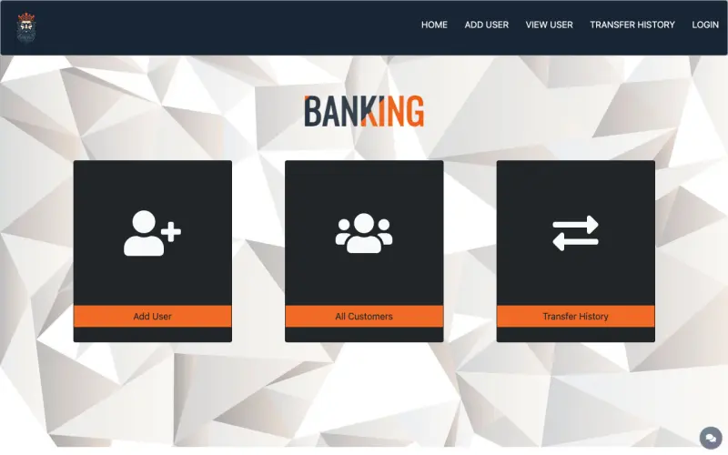
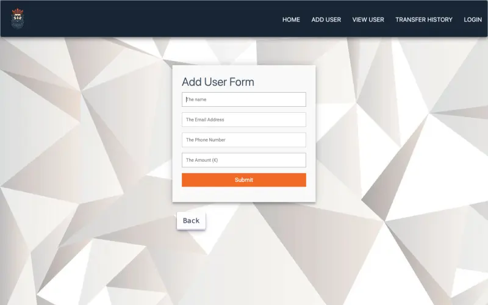

<p align="center"></p>

# BanKing

A small full-stack banking back office: manage customers, transfer money between them and chat with support in real time.

[](https://github.com/LaCobble/BanKing/actions/workflows/ci.yml)


[](LICENSE)

## What it does

BanKing is a server-rendered web application built with Node.js, Express and EJS on top of MongoDB. It exposes CRUD operations on bank customers through a responsive Bootstrap interface:

- **Add customer**: name, e-mail, phone number and initial balance.
- **All customers**: list, view details, delete.
- **Transfers**: move money from one customer to another; every transfer is stored in a **transfer history**.
- **Administrator login** and dashboard.
- **Support chat**: a floating chat button connects visitors to an administrator in real time with Socket.IO.

## Screenshots

<p>
  
  
</p>

<sub>Rendered locally from this repository (October 2026).</sub>

## Prerequisites

- Node.js 18 or later (the CI uses Node 20) and npm
- A MongoDB database (local `mongod`, Docker or a hosted cluster)

## Getting started

```bash
git clone https://github.com/LaCobble/BanKing.git
cd BanKing
npm ci
cp .env.example .env    # then set DB_URL to your MongoDB connection string
npm start               # or `npm run dev` for auto-reload with nodemon
```

Open http://localhost:5000 (or the `PORT` you set).

| Variable | Purpose | Default |
| --- | --- | --- |
| `DB_URL` | MongoDB connection string | none (required) |
| `PORT` | HTTP port | `5000` |

There is no automated test suite; the CI installs the dependencies, checks the JavaScript syntax, loads every server module and scans for secrets.

## Project structure

```
BanKing/
├── index.js            # Express + Socket.IO server
├── database/db.js      # MongoDB connection (Mongoose)
├── model/              # Mongoose models: customers, admins, transfer history
├── router/index.js     # All routes (customers, transfers, history, login, dashboard, chat)
├── views/              # EJS templates and shared components
└── public/             # Static assets: CSS, images, landing page, chat client script
```

## What it demonstrates

- Building a REST-style CRUD back end with Express and Mongoose.
- Server-side rendering with EJS templates and reusable partials.
- Real-time messaging with Socket.IO.
- Configuration through environment variables (`dotenv`).

## Known limitations

This is a learning project and is not meant for production. In particular, the administrator password is compared in plain text (the `bcrypt` dependency is not wired in) and `express-session` is imported but never mounted, so the admin login/dashboard flow is incomplete.

## Context

Personal / school project built in June 2023 while learning full-stack JavaScript. It is kept as a portfolio piece and is no longer actively developed.

## Contributing

See [CONTRIBUTING.md](CONTRIBUTING.md) and the [Code of Conduct](CODE_OF_CONDUCT.md). Security issues: [SECURITY.md](SECURITY.md).

## License and credits

[MIT](LICENSE) © LaCobble. Built with [Express](https://expressjs.com/), [EJS](https://ejs.co/), [Mongoose](https://mongoosejs.com/), [Socket.IO](https://socket.io/), [Bootstrap](https://getbootstrap.com/) and [Font Awesome](https://fontawesome.com/).
